- .
{:toc}
---

## Definice grafu
**Graf** je uspořádaná dvojice $$(V,E)$$, kde:
- $$V$$ je konečná neprázdná množina **vrcholů** (vertices)
- $$E \subseteq \binom{V}{2}$$ je množina **hran** (edges) 

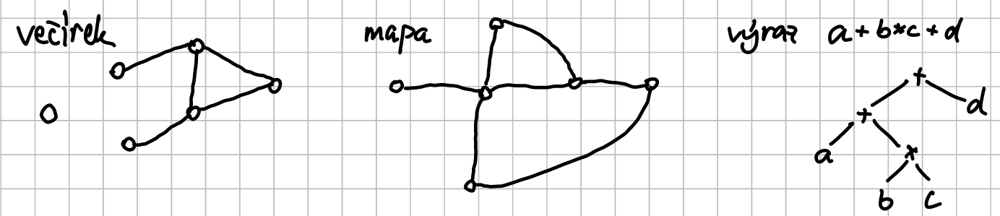

### Značení
- $$G$$ – graf
- $$V(G)$$ – vrcholy grafu $$G$$
- $$E(G)$$ – hrany grafu $$G$$

### Rozšíření
- Hrany mohou být:
	- Orientované – propojují vrcholy grafu jenom jedním směrem
	- Smyčky – propojují vrchol se sebou samým
	- Paralelní – více hran mezi dvojicí vrcholů (Multigraf)
- Graf může být nekonečný – množina vrcholů nemusí být konečná

---

## Zoo grafů
- **Úplný graf $$K_n$$**
	- každé dva vrcholy mají mezi sebou hranu
	- \$$V(K_n) := \{1,\dots,n\}$$
	- \$$E(K_n) := \binom{V(K_n)}{2}$$
	
	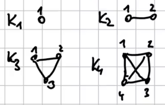

- **Prázdný graf $$E_n$$**
	- žádné vrcholy nemají hranu
	- \$$V(E_n) := \{1,\dots,n\}$$
	- \$$E(E_n) := \emptyset$$

	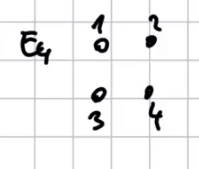

- **Cesta $$P_n$$**
	- vrcholy jsou spojené do "čáry"
	- \$$V(P_n) := \{0,\dots,n\}$$
	- \$$E(P_n) := \{\{i,i+1\} \mid 0 \leq i < n \}$$

	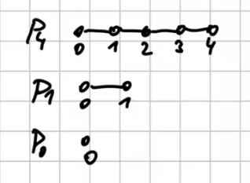

- **Kružnice $$C_n$$**
	- \$$V(C_n):= \{0,\dots,n-1\}$$
	- \$$E(C_n):=\{\{i, (i+1) \bmod n \} \mid 0 \leq i < n \}$$

	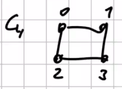

- **Úplný bipartitní graf $$K_{m,n}$$**
	- \$$V(K_{m,n}) := \{a_1, \dots, a_m\} \cup \{b_1, \dots, b_n \}$$
	- \$$E(K_{m,n}) := \{\{a_i,b_j\} \mid 1 \leq i \leq m, 1 \leq j \leq n \}$$

	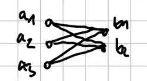

### Bipartitní graf

Graf $$G$$ je bipartitní právě tehdy, když $$\exists$$ rozklad $$V(G)$$ 
na $$X,Y$$ tak, že $$E(G) \subseteq \{\{x,y\} \mid x \in X, y \in Y \}$$

nebo

$$\forall e \in E(G): \lvert e \cap X \rvert = 1 \land \lvert e \cap Y \rvert = 1 $$


**Příklady:**  
- Cesty (rozdělíme na sudé a liché vrcholy)
- Kružnice se sudým počtem vrcholů
- prázdné grafy (můžeme rozdělit jakkoliv)
- první dva úplné grafy $$K_1$$ a $$K_2$$ (ve zbylých je vždy trojúhelník $$\implies$$ 
lichá kružnice)

---

## Izomorfismus

Grafy $$G$$ a $$H$$ jsou **izomorfní** (značíme $$G \cong H$$) $$ \equiv \exists f: 
V(G) \rightarrow V(H)$$ bijekce tak, že $$\forall u,v \in V(G): (\{u,v\} \in E(G) 
\iff \{ f(u), f(v) \} \in E(H))$$

$$\Downarrow$$

$$\text{Až na jména vrcholů se jedná o stejný graf}$$

|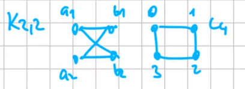|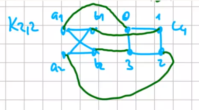|


**Pozorování:**  
Na libovolné množině grafů je izomorfismus ( $$\cong$$) ekvivalence. 

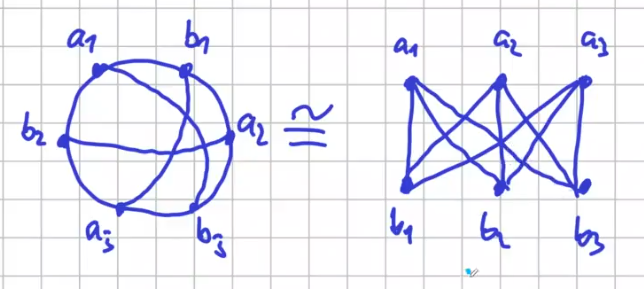

---

## Stupeň vrcholu
**Definice:**  
**Stupeň vrcholu** $$v$$ v grafu $$G$$ je

$$ \deg_G(v) := |\{u \in V(G) | \{u,v\} \in E(G)\} | $$

$$\Downarrow$$

$$ \#\text{hran vedoucích z vrcholu } v $$

Graf je **$$k$$-regulární** (pro $$k \in \N$$) $$\equiv \forall u \in V(G): \deg_G(u) 
= k$$  
Graf je **regulární** $$\equiv \exists k:G$$ je $$k$$-regulární

---

## Skóre grafu
**Definice:**  
**Skóre** grafu $$G$$ je posloupnost stupňů všech vrcholů (až na uspořádání)

---

## Věta o principu sudosti

$$ \sum_{v \in V} \deg(v) = 2\cdot|E| $$

Důsledky: $$\sum_v \deg(v)$$ je sudé $$\implies \#v \in V$$ lichého stupně je sudý

---

## Věta o skóre
Posloupnost $$D = d_1 \leq \dots \leq d_n$$ pro $$n \geq 2$$ je skóre grafu $$\iff D' = 
d'_1, \dots, d'_{n -1}$$ je skóre grafu:
- $$d'_i = d_i$$ pro $$i < n - d_n$$
- $$d'_i = d_i -1$$ pro $$i \geq n - d_n$$

> **Důkaz:**  
> $$\Leftarrow$$ nechť $$G'$$ je graf se skóre $$D'$$ a vrcholy $$v_1, \dots, v_{n-1}$$ tak, 
> že $$\forall i: \deg_{G'}(v_i) = d'_i$$. Vytvoříme $$G$$ se skóre $$D$$ doplněním vrcholu 
> $$v_n$$ a hran $$\{v_i,v_n\}$$ pro $$i \in \{n-d_n,\dots, n-1\}$$
>
>> **Lemma**: Nechť $$\mathbb{G}$$ je množina všech grafů se skóre $$D$$ vrcholech 
>> $$\{1,\dots,n\}$$ se skóre $$D,\mathbb{G} \neq \emptyset \Rightarrow \exists G \in 
>> \mathbb{G}: \{v_i,v_n\} \in E(G)$$ pro všechna $$i \in \{n-d_n, n-1 \}$$
>
> **Důkaz lemmatu:**  
> Pro $$G \in \mathbb{G}$$ definujeme $$j(G):= \max\{j \mid \{ v_j, v_n\} \notin E(G) \}$$

---

## Grafy na množině

### Počet grafů na množině
Pro množinu vrcholů $$V := \{1,\dots,n\}$$ existuje:

$$ \# \text{grafů} (V,E) = \lvert 2^{\binom{n}{2}} \rvert = 2^{\binom{n}{2}} $$

kde $$E \subseteq \binom{V}{2}$$. 

### Počet tříd izomorfismu
Pro $$n = 3$$ existují 4 grafy ($$\kern-1em\mod{}$$ izomorfismus) 

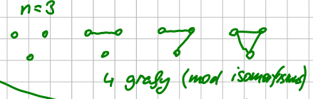

Určit přesné množství tříd izomorfismu je obtížné, ale můžeme udělat spodní odhad.
Protože třída izomorfismu může obsahovat maximálně $$n!$$ grafů $$\implies$$ $$\#$$tříd 
izomorfismu je 

$$\geq \frac{2^{n \choose 2}}{n!}$$

Takže platí

$$ 2^{n \choose 2} \geq \#\text{tříd izomorfismu} \geq \frac{2^{n \choose 2}}{n!} $$

Což v logaritmickém měřítku je:

$$
\log_2 \left(\frac{2^{n \choose 2}}{n!}\right) \leq
\log_2 \left(\#\text{tříd izomorfismu}\right) \leq
\log_2 \left(2^{n \choose 2}\right)
$$

$$\Downarrow$$

$$
\frac{\log_2 \left(2^{n \choose 2}\right)}{\log_2 (n!)} \leq
\log_2({\#\text{tříd izomorfismu}}) \leq 
{n \choose 2}
$$

$$\Downarrow$$

$$ \sim{n^2} - n\log n \leq \log({\#\text{tříd izomorfismu}}) \leq \sim{n^2} $$
 

## Podgrafy

> **Definice:**  
> Graf $$G' = (V',E')$$ je podgrafem grafu $$G=(V,E)$$ (značíme jako $$G' \subseteq 
> G$$) $$\equiv V' \subseteq V \land E' \subseteq E$$.

### Indukovaný podgraf
> **Definice:**  
> Graf $$G' = (V',E')$$ je indukovaným podgrafem $$G=(V,E)$$ (značíme jako $$G[V']$$) 
> $$\equiv V' \subseteq V \land E' = E \cap {V' \choose 2}$$
>
> Čteme jako: _Podgraf indukovaný množinou_ $$V' \subseteq V$$

### Cesta v grafu
Cesta v grafu $$G = (V,E)$$ je:
1. $$G' \subseteq G : G' \cong P_n$$ pro nějaké $$n$$
2. $$(v_0,e_1,v_1,e_2,v_2,\dots,e_n,v_n)$$, kde:
	- $$v_0, \dots, v_n$$, jsou navzájem různé 
	- $$e_1, \dots, e_n$$ jsou hrany
	- \$$\forall i : e_i=\{v_{i-1},v_i\}$$
3. Posloupnost vrcholů spojených postupně hranami

**NENÍ** posloupnost hran, kdy každá má s následující hranou společný vrchol.  
Protipříklad:

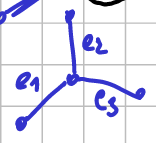

### Kružnice (cyklus) v grafu
1. $$G' \subseteq G : G' \cong C_n$$ pro nějaké $$n$$
2. \$$(v_0, e_0, v_1, e_1,\dots,v_{n-1}, e_{n-1}, v_0)$$
	- $$v_0, \dots, v_{n-1}$$ jsou navzájem různé 
	- $$e_0, \dots, e_{n-1}$$ jsou hrany
	- \$$\forall e_i = \{v_i, v_{(i+1)\bmod n}\}$$

## Souvislý graf
> **Definice:**  
> Graf $$G$$ je souvislý $$\equiv \forall u,v \in V(G) \exists$$ cesta v $$G$$ s 
> krajními body $$u,v$$

### Dosažitelnost
> **Definice:**  
> Dosažitelnost v $$G$$ je relace na $$V(G)$$, taková, že $$u \sim v \equiv$$ cesta v
> $$G$$ s krajními vrcholy $$u,v$$.
>> **Lemma:**  
>> Relace $$\sim$$ je ekvivalence
>>> **Důkaz lemmatu:**  
>>> Reflexivní: $$u \sim u$$: existuje triviální cesta  
>>> Symetrie: $$ u \sim v$$: mezi $$u$$ a $$v$$ existuje cesta $$\equiv$$ mezi $$v$$ a 
>>> $$u$$ existuje cesta  
>>> Tranzitivita: $$u \sim v \land v \sim w \implies u \sim w$$ 

### Komponenty souvislosti
> **Definice:**  
> Komponenty souvislosti jsou podgrafy indukované třídami ekvivalence $$\sim$$

Pozorování:  
- komponenty jsou souvislé
- graf je souvislý $$\equiv$$ má 1 komponentu souvislosti

---

## Procházení grafů

### Sled
Sled (walk) – posloupnost $$(v_0,e_1,v_1,e_2,\dots,e_n,v_n) \forall i$$ 
$$e_i=\{v_{i-1},v_i \}$$  
Libovolná posloupnost na sebe navazujících vrcholů a hran, ve které se může cokoli 
opakovat.

### Tah
Tah je sled, kde se neopakují hrany

### Cesta
Cesta je sled, kde se neopakují hrany ani vrcholy

> **Lemátko:**  
> $$\exists$$ cesta mezi $$u,v \iff \exists$$ sled mezi $$u,v$$  
>> **Důkaz:**  
>> $$\Rightarrow$$ triviální  
>> $$\Leftarrow$$ uvažujme sled $$S$$
>> - kdyby se v $$S$$ neopakovaly vrcholy, je to cesta
>> - pokud $$v_{k} = v_{l}$$ a $$k < l$$ tak:  
>>
>> $$v_{0}, e_{1}, v_{1}, \dots, e_{k}, v_{k}, e_{k+1}, \dots,e_{l}, v_{l}, e_{l+1}, \dots, e_{n},v_{n}$$  
>>
>> $$\downarrow$$
>>
>> $$v_{0}, e_{1}, v_{1}, \dots, e_{k}, v_{k} = v_{l}, e_{l+1}, \dots, e_{n},v_{n}$$  
>>
>> Postupným vystříháváním cyklů vznikne cesta

---

## Matice sousednosti

> **Definice:**
>
> $$
> A_{ij} := \left\{
>	\begin{array}{ll}
>      0 & \text{jinak} \\
>      1 & \text{pokud } \{v_i,v_j\} \in E(G) 
>	\end{array} 
> \right.
> $$
>
> nebo
>
> $$A_{ij} := \left[\{v_i,v_j\} \in E \right]$$

| | $$\implies$$ | $$ \begin{array}{c c} & \begin{array}{c} v_1 \kern0.6em v_2 \kern0.6em v_3 \kern0.6emv_4 \\ \end{array} \\ \begin{array}{c c c} v_1 \\ v_2 \\ v_3 \\ v_4 \end{array} \kern-1.7em & \left[ \begin{array}{c c c c} 0 & 1 & 1 & 0 \\ 1 & 0 & 1 & 0 \\ 1 & 1 & 0 & 1 \\ 0 & 0 & 1 & 0 \end{array} \right] \end{array}$$ |

Pozorování:  
- $$A$$ je symetrická
- součty řádků/sloupců jsou stupně vrcholů

### Umocňování matice sousednosti

$$ A^2_{ij} = (A\cdot A)_{ij} = \sum_k A_{ik} \cdot A_{kj} = \sum_k [\{v_i,v_k\} \in E]\cdot[\{
v_k,v_j \} \in E] $$

- $$\{v_i,v_k\}$$ a $$\{v_k,v_j \}$$ jsou hrany
- $$\exists$$ sled délky 2 z $$v_i$$ do $$v_j$$ přes $$v_k$$

$$ = \#\text{sledů délky } 2 \text{ z } v_i \text{ do } v_j$$

> **Lemma:**
>
> $$A^t_{ij} = \#\text{sledů délky } t \text{ z } v_i \text{ do } v_j$$
>
>> **Důkaz:**
>> 1. $$t = 1$$ – matice sousednosti – triviální
>> 2. $$t \rightarrow t+1: A^{t+1}_{ij} = (A^t\cdot A)_{ij} = \sum_k A^t_{ik}A_{kj} = \sum_k 
>> \#$$sledů délky $$t$$ z $$v_i$$ do $$v_k$$

### Počet trojúhelníků v grafu

\$$\#\text{podgrafů izomorfních s } K_3 = \#\text{uzavřených sledů délky } 3 \text{ z }
v_i \text{ do } v_i = {\sum_i A^3_{ii} \over 6}$$

---

## Grafová metrika

> **Definice:**  
> Grafová metrika (vzdálenost) v souvislém grafu $$G$$:  
>
> $$d_G: V^2 \rightarrow \N$$  
> $$d_G(u,v) :=$$ minimum z délek (počet hran) cest mezi $$u$$ a $$v$$
>
>> **Lemma:**
>> 1. \$$d_G(u,v) \geq 0$$
>> 2. \$$d_G(u,v) = 0 \iff u = v$$
>> 3. \$$d_G(u,v) = d_G(v,u)$$
>> 4. \$$\bigtriangleup\text{nerovnost: }d_G(u,v) \leq d_G(u,w) + d_G(w,v)$$

---

## Grafové operace
Nechť $$G=(V,E)$$
- Přidání vrcholu či hrany: $$G+v$$, $$G+e$$
- Smazání vrcholu či hrany: $$G-v=G[V(G) \setminus \{v\}]$$, $$G-e$$
- Dělení hrany: $$G \% e = G + x - e + \{u,x\} + \{v,x\}$$
	- $$V' := V \cup\{x\}$$ pro $$x \notin V$$
	- \$$E' := E \setminus \{\{u,v\}\} \cup \{\{u,x\},\{v,x\}\}$$
- Kontrakce hrany: $$G.e = G - u - v + x + (e \setminus \{u,v\} \cup \{x\})$$

Pozorování:  
- cesty lze vyrábět postupným dělením $$P_1$$
- kružnice lze vyrábět postupným dělením $$C_3$$

---

## Eulerovské grafy

**Definice:**  
Eulerovský tah je takový, který obsahuje všechny vrcholy a hrany grafu.

**Definice:**  
Graf je eulerovský $$\equiv$$ existuje v něm uzavřený eulerovský tah.

> **Věta o Eulerových grafech:**  
> Graf $$G$$ je eulerovský $$\iff G$$ je souvislý $$\land \forall v \in V(G): 
> \deg_G(v)$$ je sudý.
>
>> **Důkaz:**  
>> $$\implies$$ souvislostí $$\forall u,v \in V(G) \exists$$ tah mezi u,v $$\implies 
>> \forall$$ cesta mezi $$u,v$$
>>
>> **$$T$$ je uzavřený:** Sporem:  
>> - nechť $$u$$ je jeden z konců tahu, který je nejdelší a otevřený 
>> - tah obsahuje lichý $$\#$$hran incidentních s $$u$$
>> - $$u$$ má sudý $$\deg(u) \implies \exists$$ nepoužitá hrana, což je ve sporu s 
>> předpokladem, že je nejdelší možný $$\rightarrow$$ Každý nejdelší tah je uzavřený.
>>
>> **$$T$$ je eulerovský:**  
>> a. pokud $$\{u,v\} \in E(G), u,v \in T$$, pak $$\{u,v\} \in T$$  
>>     - kdyby to pro nějaké $$\{u,v\}$$ nebyla pravda (předpoklad a.), tak $$T$$ "rozpojíme"
>> při některém z průchodů z $$u$$: $$u,...u$$ a nakonec přidáme $$\{u,v\},v \rightarrow$$ 
>> delší tah a to je spor
>>
>> b. $$T$$ obsahuje všechny vrcholy
>> - když $$\exists u \in V(G) \land u \notin T$$:
>> 1. tak zvolíme $$v \in T$$ libovolně
>> 2. pak díky souvislosti $$G \implies \exists$$ cesta $$C$$ mezi $$u$$,$$v$$
>> 3. $$\exists r$$ a $$s \in C: r \in T, s \notin T, \{r,s\} \in E(G)$$,
>> 4. $$T$$ rozpojíme v $$r$$ a prodloužíme $$\{r,s\},s \implies$$ delší tah a to je 
>> spor

---

## Orientované grafy
Je to běžný graf, jen hrany jsou uspořádané dvojice vrcholů. Těmto orientovaným 
hranám se může říkat "šipky". Matice sousednosti už nemusí být symetrická.

**Definice:**

$$ E \subseteq V^2 \setminus \{(x,x) \mid x \in V \} $$

Stupně vrcholu rozlišujeme na vstupní stupeň a výstupní stupeň.

**Definice:**  
$$
\begin{aligned}
  \deg^{\text{in}}(v) &:= \#u: (u,v) \in E \\
  \deg^{\text{out}}(v) &:= \#w: (v, w) \in E
\end{aligned}
$$

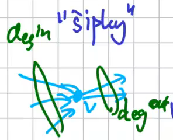

### Vyvážený orientovaný graf
**Definice:**  
Graf je _vyvážený_ $$\equiv \forall v \in V \deg^{\text{in}}(v) = \deg^{\text{out}}(v)$$

### Podkladový graf
**Definice:**  
Pro orientovaný graf $$G = (V,E)$$: _podkladový graf_ $$G^0 = (V,E^0)$$, kde $$\{u,v\}
\in E^0 \equiv (u,v) \in E \lor (v,u) \in E$$.

(Prostě u hran grafu $$G$$ zapomeneme orientaci.)

### Souvislost 
Má dva pohledy:  

1. **Slabá souvislost** – graf drží pohromadě 
	- **Definice:** podkladový graf je souvislý
	- není možné množinu vrcholů rozdělit na dvě, aby mezi nimi neexistovala hrana.

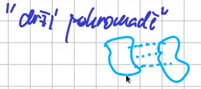

2. **Silná souvislost** – dosažitelnost všude
	- **Definice:** $$\forall u,v \in V \exists$$ orientovaná cesta z $$u$$ do $$v$$
	- z každého vrcholu se dá po hranách přejít do jiného.
	- implikuje slabou souvislost

Pro neorientovaný graf oba pojmy splývají, pro orientovaný už ne.

### Polosouvislost
**Definice:**  
$$ \forall u,v \in V(G) \exists$$ cesta z $$u$$ do $$v$$ nebo z $$v$$ do $$u$$.

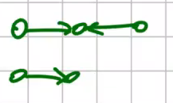

### Věta o orientovaných grafech
> **Věta:**  
> Následující vlastnosti orientovaného grafu $$G$$ jsou ekvivalentní:
> 1. $$G$$ je vyvážený a slabě souvislý
> 2. $$G$$ je eulerovský
> 3. $$G$$ je vyvážený a silně souvislý
>
>> **Důkaz:**
>> 3. $$\implies$$ 1.
>> 2. $$\implies$$ 3.
>> - vyváženost – triviální
>> - silná souvislost – $$\forall u,v \exists$$ orientovaný tah $$u \rightarrow v 
>> \implies \exists$$ orientovaná cesta $$v \rightarrow u$$
>> 3. $$\implies$$ 2.
>> - lehce upravíme důkaz pro neorientovaný graf.

---

## Stromy
**Definice:**  
Graf $$G$$ je *strom* $$\equiv G$$ je souvislý $$\land$$ acyklický. Ve $$V(G)$$ je
*list* $$\equiv \deg_G(v) = 1$$

| Strom výrazu | Strom hierarchie království |
|:------------:|:---------------------------:|
| 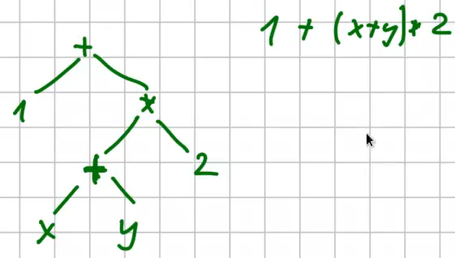 | 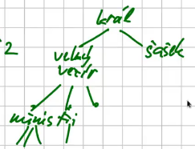 |

> **Věta o charakterizaci stromů**
>
> Pro graf $$G$$ jsou následující tvrzení ekvivalentní:
> 1. $$G$$ je souvislý a acyklický
> 2. $$\forall u,v\in V(G) \exists!$$ cesta mezi $$u$$,$$v$$ v $$G$$ (jednoznačně souvislý)
> 3. $$G$$ je souvislý a $$\forall e \in E(G): G-e$$ není souvislý (minimálně souvislý)
> 4. $$G$$ je acyklický a $$\forall e \in \binom{V(G)}{2} \setminus E(G + e)$$ obsahuje 
> cyklus (maximálně acyklický)
> 5. $$G$$ je souvislý a $$\mid E(G) \mid = \mid V(G) \mid -1$$
>
>> **Důkaz:**  
>> Pro $$n$$: Každý graf s $$\mid n \mid = n$$ splňuje **1.** $$\implies$$ **2.**  
>> Krok $$n-1 \rightarrow n$$: Buď $$G$$ graf s $$n$$ vrcholy.
>> Platí-li **1**, $$G$$ je strom $$\implies \exists l$$ (list) a $$s$$ (jediný soused) 
>> $$l$$.
>> $$G-l$$ je také strom, má $$n-1$$ vrcholů $$\implies G - l$$ je jednoznačně souvislý.  
>>
>> Jednoznačná souvislost $$G$$: nechť $$u,v \in V \rightarrow $$
>> - \$$u,v \neq l$$
>>    * Přidáním listu nevzniká nová cesta
>> - bez újmy na obecnosti $$u = l, v \neq l$$
>>    * cesta $$v..l$$ jde přes $$s$$ mezi $$v,s \exists!$$ cesta (z indukčního 
>> 		předpokladu) a tu jde rozšířit jedním způsobem a to přidáním hrany $$s,l$$
>> - \$$ u,v = l$$
>>    * existuje jen jedna cesta
>>
>> - 1\. $$\implies$$ 3. (indukce)
>> - 1\. $$\implies$$ 4. (indukce)
>> - 1\. $$\implies$$ 5. (indukce pro $$n=1: \lvert V \rvert = 1, \lvert E \rvert = 0$$)
>> - 2\. $$\implies$$ 1. ($$\neg$$1. $$\implies \neg$$2.)
>> - 3\. $$\implies$$ 1. ($$\neg$$1. $$\implies \neg$$3.)
>> - 4\. $$\implies$$ 1.
>> - 5\. $$\implies$$ 1.
>>

> **Lemma:**  
> Je-li $$G$$ strom na alespoň 2 vrcholech, $$G$$ má alespoň 2 listy.
>
>> **Důkaz:**  
>> Uvažme nejdelší cestu ve stromu:
>>
>> 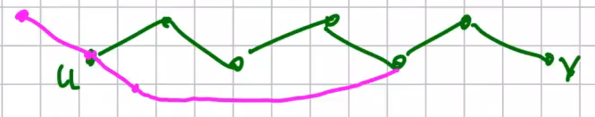
>>
>> $$u$$, $$v$$ jsou listy, protože kdyby $$u$$ nebyl list: $$\exists t: \{t,u\}$$ je 
>> hrana, která neleží na cestě:
>> 1. $$t, \{u,t\}, P$$ nejdelší cesta 
>> 2. část cesty $$u...t + \{t,u\}$$ tvoří cyklus

> **Lemma:**  
> Nechť $$v$$ je list grafu $$G$$. Pak $$G$$ je strom $$\iff$$ $$G - v$$ je strom.
>
>> **Důkaz:**  
>> $$\implies$$
>> - $$G-v$$ je souvislý (pokud mezi $$x$$, $$y \neq v \exists$$ cesta v $$G$$, pak
>> leží i v $$G-v$$)

### Les
Graf $$G$$ je les $$\equiv G$$ je acyklický $$\iff G$$ je les, když všechny jeho 
komponenty souvislosti jsou stromy.

### Kostra grafu

**Definice:**  
$$T \subseteq G$$ je *kostra* grafu $$G \equiv T$$ je strom $$\land \lvert V(T) \rvert = 
\lvert V(G) \rvert$$

**Větička:**  
Graf má kostru $$\iff$$ je souvislý

**Důkaz:**  
$$\Rightarrow$$ trivka  
$$\Leftarrow$$ Mažeme hrany na cyklech, dokud nevznikne strom.

---
## Nakreslení grafu

### Nakreslení do roviny 
> **Věta:**
> Hranice stěny souvislého topologického grafu je nakreslením uzavřeného sledu.
>
>> **Důkaz:**  
>> 1. $$\lvert E \rvert = \lvert V \rvert -1$$, graf je strom – platí
>> 2. indukční krok: Graf není strom. Nechť $$e$$ je hrana na kružnici $$\implies e$$
>> odděluje 2 stěny.
>>
>> 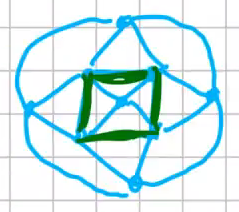
>>
>> Pro $$G' := G - e$$ věta platí, $$o(e) \cup s_1 \cup s_2$$ je stěna  $$\rightarrow$$
>> je uzavřena na dvě části, každou uzavřeme hranou $$e$$.
>>
>> 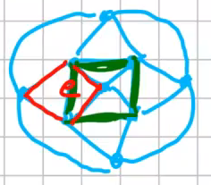
>> 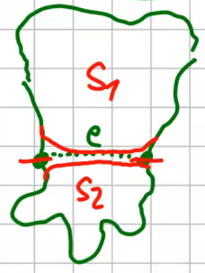

Graf $$G$$ má rovinné nakreslení $$\iff$$ má nakreslení lomenými čarami.

Dělení hran zachová rovinnost, kontrakce také: je-li $$G$$ rovinný, pak $$G \setminus
e$$ také. Graf je rovinný, když jeho libovolné dělení je rovinné. Rovinný bude i po 
kontrakci hran také rovinný.

| 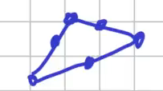 | 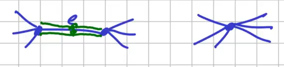 |

$$K_5$$ a $$K_{3,3}$$ nejsou rovinné a jejich dělení také ne. Pokud graf obsahuje 
$$K_5$$ nebo $$K_{3,3}$$ jako podgraf, také není rovinný.

### Kuratowského věta
> Graf není rovinný $$\iff$$ obsahuje podgraf izomorfní nějakému dělení $$K_5$$ nebo
> $$K_{3,3}$$.

### Jordanova věta o kružnici
> Je-li $$c$$ topologická kružnice v $$\R^2$$, pak $$\R^2 \setminus c$$ má právě dvě
> komponenty obloukové souvislosti: omezenou a neomezenou a $$c$$ je jejich společnou 
> hranicí.

**Důsledek:**  
$$K_5$$ není rovinný.

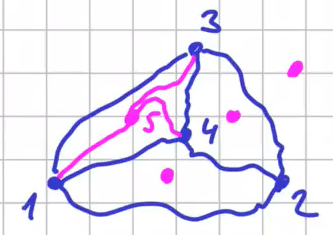

$$K_{3,3}$$ je také nerovinný

### Nakreslení na sféru
> **Věta**  
> Graf má nakreslení na sféru $$\iff$$ má nakreslení do roviny.
>
>> **Důkaz stereografickou projekcí**  
>> spojitá bijekce mezi sférou bez severního pólu a $$\R^2$$
>>
>> 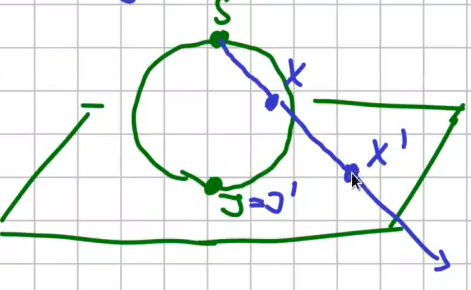

### Válcová plocha (plášť válce)
Totéž jako rovina

### Nakreslení na torus
"Povrch pneumatiky". Můžeme na něj nakreslit vše, co do roviny, ale opačně to neplatí.

### Eulerova formule
> Je-li graf $$G$$ nakreslený do roviny:
>
> - \$$v = \lvert V(G) \rvert$$
> - \$$e = \lvert E(G) \rvert$$
> - \$$f = \#\text{stěn nakreslení}$$
>
> $$ v + f = e + 2 $$
>
>> **Důkaz:**  
>> 1.$$G$$ je strom: víme, že $$v-1 = e \rightarrow v = e + 1$$, $$f=1 : v + f = v + 1
>> = e + 2$$
>>
>> 2. indukční krok:  
>> Nechť $$e$$ je hrana na kružnici a $$G' := G - e$$ ... parametry:
>> - \$$v' = v$$
>> - \$$e' = e - 1$$
>> - \$$f' = f -1$$
>>
>> $$\Downarrow$$
>>
>> $$
>> \begin{aligned}
>>   v' + f' &= e' + 2 \\
>>   v + f - 1 &= e - 1 + 2 \\
>>	 v + f &= e + 2
>> \end{aligned}
>> $$

**Důsledek:**  
Stěny jsou vlastnost nakreslení. Všechna nakreslení téhož grafu mají stejný počet stěn.

### Maximální rovinný graf
> **Definice:**  
> $$G$$ je maximální rovinný $$\equiv G$$ je rovinný $$\land \forall e \in {V(G) \choose 2}
> \setminus E(G): G + e$$ není rovinný.

> **Věta:**  
> V nakreslení maximálního rovinného grafu s minimálně 3 vrcholy jsou všechny stěny 
> trojúhelníky.
>
> **Důkaz:**  
> Nechť $$G$$ je maximální rovinný topologický graf s nakreslením.
> 1. kdyby $$G$$ nebyl souvislý (můžeme přidat hrany mezi komponentami)
> 2. kdyby $$\exists$$ stěna ohraničená $$C_n$$ pro $$n > 3$$ ($$u,v :=$$ nesousední 
> vrcholy stěny přidáme hranu $$\{ u, v\}$$ nakreslenou vnitřkem.)
> 3. jinak jsou stěny ohraničené uzavřenými sledy, které nejsou kružnice (opakuje se na něm
> vrchol $$v$$) ($$s-v$$ má více komponent, $$u,w :=$$ vrcholy různých komponent, lze 
> přidat hranu $$\{ u, w\}$$ a to je spor)

## Eulerova formule
> Je-li graf $$G$$ nakreslený do roviny:
>
> - \$$v = \lvert V(G) \rvert$$
> - \$$e = \lvert E(G) \rvert$$
> - \$$f = \#\text{stěn nakreslení}$$
>
> $$ v + f = e + 2 $$
>
>> **Důkaz:**  
>> 1.$$G$$ je strom: víme, že $$v-1 = e \rightarrow v = e + 1$$, $$f=1 : v + f = v + 1
>> = e + 2$$
>>
>> 2. indukční krok:  
>> Nechť $$e$$ je hrana na kružnici a $$G' := G - e$$ ... parametry:
>> - \$$v' = v$$
>> - \$$e' = e - 1$$
>> - \$$f' = f -1$$
>>
>> $$\Downarrow$$
>>
>> $$
>> \begin{aligned}
>>   v' + f' &= e' + 2 \\
>>   v + f - 1 &= e - 1 + 2 \\
>>	 v + f &= e + 2
>> \end{aligned}
>> $$

Pro triangulace z Eulerovy formule: 
- \$$ 3f = 2e$$
- \$$ f = \frac{2}{3}e$$

$$
\begin{aligned}
   v + f &= e + 2 \\
   v + \frac{2}{3}e &= e + 2 \\
   v - 2 &= \frac{1}{3}e \\
   3v - 6 &= e
\end{aligned}
$$

> **Věta:**  
> Nechť $$G$$ je rovinný graf s aspoň $$3$$ vrcholy, $$v = \lvert V(G) \rvert , 
> e = \lvert E(G) \rvert$$.
>
>> **Důkaz:**  
>> Nechť $$G'$$ (triangulace grafu $$G$$) je maximální rovinný graf vzniklý z $$G$$ přidáváním 
>> hran.
>> $$\downarrow$$  
>> $$ e' = 3v' - 6 $$  
>> $$ e' \geq 3v' - 6 $$  
>> $$ v' = v $$  

**Důsledky:**  
- $$K_5$$ není rovinný: $$v=5, e = {5 \choose 2} = 10 > 9$$
- Průměrný stupeň vrcholu < 6 pro všechny rovinné grafy
	- pro $$v < 3:$$ triv
	- jinak $$ \frac{\sum_w \deg(w)}{v} = \frac{2e}{v} \leq \frac{6v - 12}{v} < \frac{6v}{v} = 6$$
- V každém rovinném grafu $$\exists$$ vrchol stupně maximálně 5.

---

## Barvení map
Sousední státy (Sousední stěny topologického rovinného grafu) mají mít různé barvy
$$\rightarrow$$ _Problém čtyř barev_

Chceme barvit vrcholy: $$f: V \rightarrow \{1,\dots,k\}$$ tak, aby $$\{u,v\} \in E \implies
f(u) \neq f(v)$$

### Duální graf
$$G = (V,E)$$ se stěnami $$F \rightarrow G^*=(F,E^*)$$

$$\{f_1, f_2 \} \in E^* \iff f_1, f_2$$ sousedí v $$G$$, $$e$$ se zachová:

$$V \leftrightarrow f$$

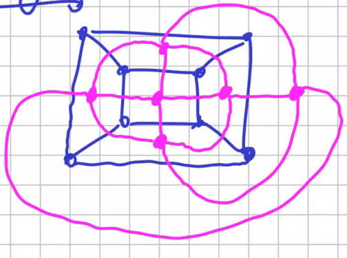

Obecně definováno na multigrafech.
